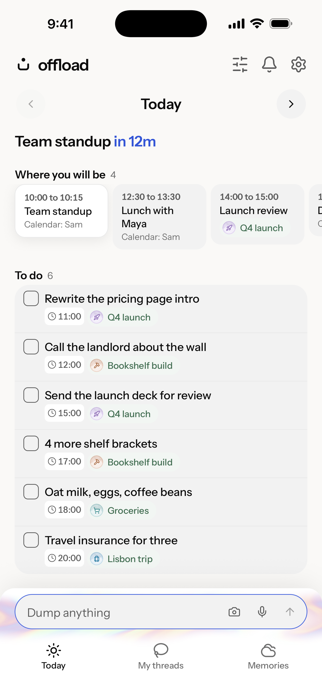
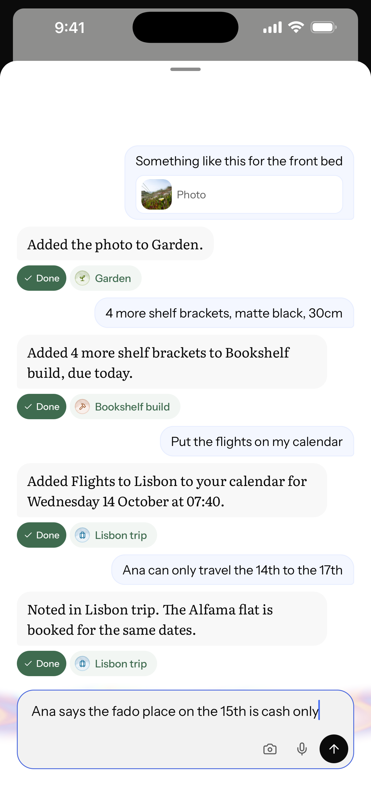
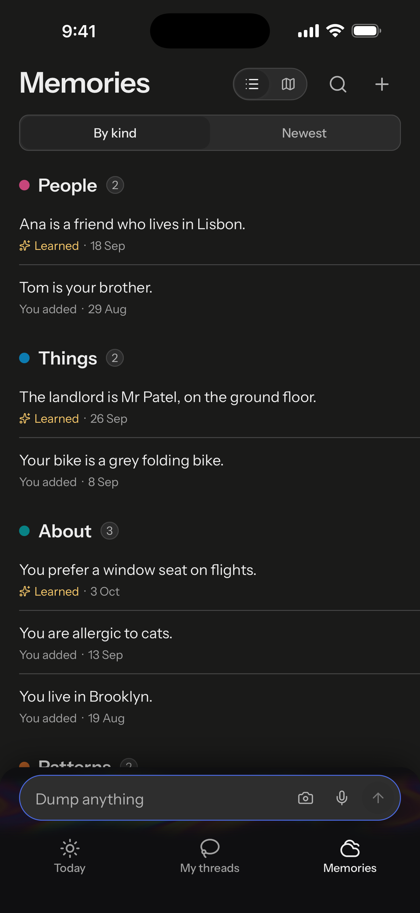

# offload

An AI assistant for organising thoughts and information day to day, alone or with other people. You dump things in, offload does the filing.

<p>
  
  
  
</p>

Notes, links, screenshots, photos, voice notes, forwarded emails: today they end up spread across a calendar, a message thread you send to yourself and a notes app, and nothing is findable later. In offload you put them down in one place without choosing a folder, a type or a format, and a model files each one into a thread, pulls out the dates and tasks, and answers questions about it later. Structure appears afterwards and can always be corrected: what offload does on its own comes with Undo, and anything that reaches other people is asked first.

offload is in alpha, invite only, and live on iOS, Android and the web at [offload.club](https://offload.club).

## What is worth a look

- **The dump path.** A dump is written to the phone's outbox first and shown at once; the API stores it, encrypts its files and queues its filing in one transaction; a Python worker runs a tool-using model loop that files it and replies with what it did. [`docs/tech/architecture.md`](docs/tech/architecture.md) walks through it.
- **The model harness and its evals.** [`apps/agent`](apps/agent) is the only process that talks to Claude: the prompts, the planner loop, the tools and their bounds. [`apps/agent/evals/principles`](apps/agent/evals/principles) holds the behaviour as principles, each with the cases that test it against the real model, and a seeded cast of people the memory evals run on.
- **Specs before code.** Every feature has a folder in [`docs/specs`](docs/specs), from `001-data-model` on: a feature spec, an implementation spec and a task list, checked against the enforced principles in [`docs/constitution`](docs/constitution). Decisions and the reasons behind them are kept in [`docs/tech/decisions.md`](docs/tech/decisions.md).
- **A design system the code obeys.** [`.claude/skills/offload-design`](.claude/skills/offload-design) holds the tokens, 21 component contracts, five click-through UI kits and the brand decisions. Lint reads its generated rule file, so a screen that drifts from it fails the build.
- **An agentic workflow.** The repository is built with Claude Code, and [`.claude`](.claude) is the harness: reviewer agents, slash commands for planning, implementing and reviewing, hooks that block secrets and refuse a commit while a test is red, and a board the parallel sessions talk through. [`CLAUDE.md`](CLAUDE.md) is the working agreement, including what has gone wrong and the rule each mistake left behind.
- **Privacy as a claim surface.** The [privacy page](<apps/web/src/app/(marketing)/privacy/page.tsx>) states in public what happens to what people put in, and a change that makes a line of it untrue is treated as a defect even when the code is correct.

## Shape

Four services and a backup job in one monorepo.

| Path | What | Stack |
| --- | --- | --- |
| `apps/mobile` | iOS and Android | Expo (React Native) |
| `apps/web` | marketing site, web app, admin panel | Next.js, three route groups |
| `apps/core-api` | data, authorization, schema, blobs, the encryption boundary | Fastify (TypeScript), Kysely |
| `apps/agent` | the only thing that talks to Claude: a worker that drains the jobs table | Python |
| `apps/backup` | the nightly sealed dump to R2 | a container on a schedule |
| `packages/` | shared TypeScript types, widgets and generated design tokens | TypeScript |
| `schemas/events` | the analytics event contract | JSON Schema |

Postgres with pgvector on Railway, files on Cloudflare R2 encrypted per object, Claude for filing and answering, Voyage for embeddings, AssemblyAI for voice notes. [`docs/tech/stack.md`](docs/tech/stack.md) has every choice and why.

## Running it

[`docs/local-dev.md`](docs/local-dev.md) sets it up locally, and [`.env.example`](.env.example) names every variable. The web app and the API need Docker and Node, the worker needs Python with `uv`, and the model, mail and storage features need keys of your own.

```bash
pnpm install
pnpm lint && pnpm typecheck && pnpm test
```

## How the work is done

Plan, gate, implement, review, driven by slash commands and grounded in `docs/`.

| Command | Purpose |
| --- | --- |
| `/plan-feature <desc>` | spec, multi-perspective review, constitution gate, impl-spec and tasks |
| `/implement <NNN-slug>` | build a feature from its artifacts |
| `/tweak <desc>` | small change, specs kept in sync |
| `/review [scope]` | on-demand deep review |

Tests come first and are seen failing before the code that passes them. `main` is production; pull requests run against a seeded Postgres in CI.

## Where to start reading

1. [`CLAUDE.md`](CLAUDE.md), how work happens in this repository.
2. [`.claude/skills/offload-design/readme.md`](.claude/skills/offload-design/readme.md), what the product is and how it looks.
3. [`docs/tech/decisions.md`](docs/tech/decisions.md), what was decided, and what is still open.

## About the public copy

[github.com/menthas-inc/offload](https://github.com/menthas-inc/offload) is a read-only copy of the private repository where the work happens, published from time to time. Its history is the real one, with a few changes on the way out: names in test fixtures are replaced, and documents about operations, security reviews and vendors' own terms are kept private, so a link to one lands on a short page that says so. Issues and pull requests are not taken there.

Found a security problem? See [`SECURITY.md`](SECURITY.md). The code is published to be read, not reused: see [`LICENSE`](LICENSE).
